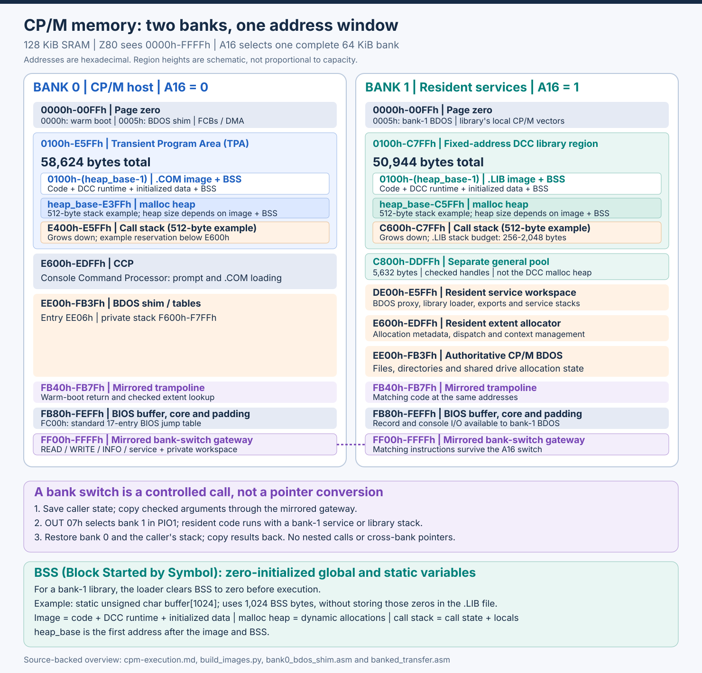
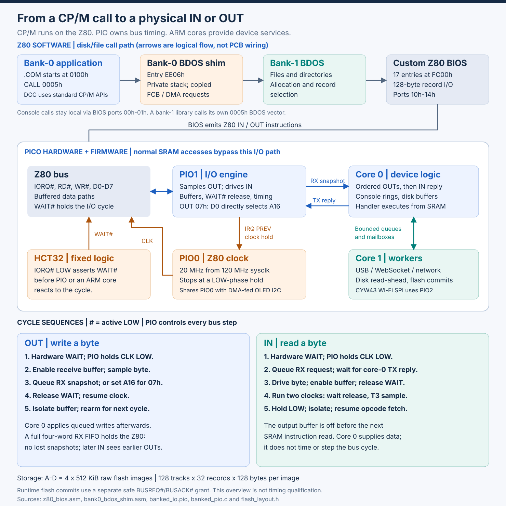

# Banked memory support

This appendix covers DCC's optional fixed-address bank-1 libraries for the
[Z80 ROM-less SBC](https://gloveboxes.github.io/Z80ROMlessSBC/). These features
depend on that project's banked SRAM, resident loader and BANKSDK runtime;
they are not part of standard CP/M 2.2 and are not needed for ordinary
single-bank `.COM` applications. Generating Z80 code alone does not provide
cross-bank calls.

Use a bank-0 `.COM` host for startup and user interaction, and a bank-1
`.LIB` service for processing and large, service-owned data. Build the library
first, then the host with its generated wrappers and BANKSDK. Calls are
synchronous and copy bounded arguments rather than sharing pointers; each
bank has its own code, data, heap and stack budget.

The memory layouts and diagrams below are adapted from the SBC project's
[CP/M execution reference](https://gloveboxes.github.io/Z80ROMlessSBC/system/cpm-execution/).
The SVG assets are included locally so this appendix can be viewed without
loading images from another site. Consult the upstream reference and
[bank-1 library specification](https://gloveboxes.github.io/Z80ROMlessSBC/cpm-dcc/bank1-library-spec/)
for the current firmware, loader and hardware details. For ordinary builds,
see [Building and linking](../02-build-and-link.md).

## Two banks, one address window

[](../images/cpm-banked-memory.svg)

Region heights are schematic. Addresses are hexadecimal and ranges inclusive
unless labelled otherwise; `#` means active LOW.

The SBC's 128 KiB SRAM has two 64 KiB banks, each mapped to `0000h`-`FFFFh`.
PIO1 completes `OUT 07h` by sending D0 to A16: 0 selects bank 0, 1 selects
bank 1. This switches code, data, stack and vectors together.

- **Bank 0:** `.COM` programs start at `0100h`; the TPA holds 58,624 bytes.
- **Bank 1:** one fixed-address `.LIB` uses `0100h`-`C7FFh`, 50,944 bytes.

Both budgets include the image (code, DCC runtime and initialized data), BSS,
`malloc` heap and call stack, not just free heap. **BSS (Block Started by
Symbol)** holds zero-initialized globals/statics. For example,
`static unsigned char buffer[1024];` reserves 1,024 bytes; the library loader
zeros them without storing those zeros in `.LIB`. Each bank's `heap_base`
follows its own linked image and BSS.

The diagram uses **512-byte call stack examples**:

| Region | Bank 0 TPA (inclusive) | Bank 1 library (inclusive) |
| --- | --- | --- |
| Image + BSS | `.COM`: `0100h` to `heap_base - 1` | `.LIB`: `0100h` to `heap_base - 1` |
| `malloc` heap | `heap_base` to `E3FFh` | `heap_base` to `C5FFh` |
| Call stack (512 bytes) | `E400h` to `E5FFh` | `C600h` to `C7FFh` |

Bank-0 placement is illustrative and application-specific. Bank 1's `.LIB`
header sets a 256-2,048-byte stack in 256-byte units below `C800h`; its last
heap byte is `C800h - stack size - 1`. The separate 5,632-byte pool at
`C800h`-`DDFFh` uses checked handles; RESET does not unload the library or
reset its `malloc` heap.

### Why switching banks does not lose execution

The `FF00h` gateway and `FB40h` trampoline have matching code in both banks,
so instruction fetching survives an A16 switch. Applications use checked
BANKSDK transfers and generated wrappers, not cross-bank pointers or
arbitrary bank toggles. The resident gateway saves and restores the caller's
bank and stack. See the SBC's
[stack switch and return reference](https://gloveboxes.github.io/Z80ROMlessSBC/system/cpm-execution/#stack-switch-and-return)
for the saved state and call sequence.

## CP/M memory map reference

These addresses describe the SBC's banked CP/M implementation, not a universal
CP/M memory map. Bank 0's TPA excludes the CCP; all resident workspace stays
above it:

| Region | Address range | Role |
| --- | --- | --- |
| Page zero | `0000h`-`00FFh` | CP/M vectors, default FCBs, DMA buffer and command tail |
| Transient Program Area (TPA) | `0100h`-`E5FFh` | `.COM` image, BSS, `malloc` heap and call stack |
| CCP | `E600h`-`EDFFh` | Console Command Processor, reloaded after a warm boot |
| BDOS shim and tables | `EE00h`-`FB3Fh` | Bank-0 console and disk/file proxy; entry at `EE06h` |
| BDOS shim private stack | `F600h`-`F7FFh` | 512-byte stack inside the BDOS slot |
| Mirrored trampoline | `FB40h`-`FB7Fh` | Bank-1 warm-boot return and checked-transfer extent lookup |
| Reserved BDOS padding | `FB80h`-`FBFFh` | 128-byte BIOS directory buffer |
| BIOS core | `FC00h`-`FEFDh` | Boot, console, disk, translation and startup-report routines |
| Spare padding | `FEFEh`-`FEFFh` | 2 bytes |
| BIOS bank extension | `FF00h`-`FFFFh` | Mirrored bank-switch code and private workspace |

Bank 1 reserves `DE00h` and above for system code:

| Bank-1 address | Role |
| --- | --- |
| `0000h`-`00FFh` | CP/M page zero |
| `0100h`-`(heap_base - 1)` | Fixed `.LIB` image and BSS |
| `heap_base`-`(C800h - stack - 1)` | Library `malloc` heap, starting after linked BSS |
| `(C800h - stack)`-`C7FFh` | Pinned library stack; size comes from the `.LIB` header |
| `C800h`-`DDFFh` | General `bmalloc` pool, 5,632 bytes |
| `DE00h`-`E5FFh` | Resident loader, proxy and service workspace |
| `E600h`-`EDFFh` | Extent allocator metadata/code |
| `EE00h`-`FB3Fh` | Authoritative CP/M BDOS |
| `FB40h`-`FB7Fh` | Mirrored warm-boot return and extent lookup |
| `FB80h`-`FEFFh` | BIOS buffer and core |
| `FF00h`-`FFFFh` | Mirrored bank-switch gateway |

## From a CP/M call to physical I/O

[](../images/cpm-pio-execution.svg)

Arrows show logical call/data flow, not PCB wires.

1. Bank-0 `CALL 0005h` enters the BDOS shim at `EE06h`.
2. Console calls stay local; disk/file calls copy File Control Blocks (FCBs)
   and software DMA buffers to bank 1 using the private `F600h`-`F7FFh` stack.
3. Bank-1 BDOS selects files and records, then calls BIOS at `FC00h`.
   Libraries reach it through their own `0005h` vector.
4. BIOS emits port I/O; PIO1 completes the bus cycle, core 0 supplies device
   data, and core 1 handles queued storage/transport work.

The Z80 executes CP/M directly from SRAM; the Pico supervises boot and I/O
rather than emulating the CPU. See the SBC's
[PIO I/O engine reference](https://gloveboxes.github.io/Z80ROMlessSBC/system/cpm-execution/#pio-io-engine-reference)
for hardware-specific timing and device details.

## Composite projects

A parent `dccmake.txt` can build an ordered collection of child projects:

```ini
# LIBDEMO/dccmake.txt
dcc-projects=lib,host
```

Run `dccmake` in the parent directory. Each listed directory must contain
its own `dccmake.txt`; paths resolve relative to the containing parent.
The library builds first and generates the typed host wrappers before the
host compiles. Each child retains its own inputs, output format, tools,
and build directory. Nested composite projects are supported, with cycle
detection and a maximum of 16 composite levels. A failed child stops the
remaining builds and makes the root invocation fail.

Parent configurations contain only `dcc-projects` and an optional
`dcc-library-linker`. Keep compilation settings in children; common
command-line overrides are forwarded to each child. `dcc-input` and
`dcc-output` cannot be overridden on a composite invocation.

```sh
dccmake dcc-library-linker=/path/to/dcc/l80c
```

The library-specific linker override applies only to LIB children, leaving
COM children on their ordinary linker. It can also be used for a standalone
library build. A composite builds outputs in their child build directories;
it does not install files or make disk updates transactional.

## Fixed-address bank-1 libraries

`dcc-output-format=lib` builds a fixed-address CP/M bank-1 library, not a
LINK-80 object archive. DCC's native `l80c` implements this format through
its `--lib` mode; emulated `L80.COM` does not.

Keep the host and library in separate directories, each with a
`dccmake.txt` and `build/` directory. For example, the library configuration
can contain:

```ini
dcc-input=LIB.C
dcc-output=SPREADS
dcc-output-format=lib
dcc-exports=auto
dcc-library-api=auto
dcc-library-host-dir=../host/generated
dcc-stack-bytes=512
dcc-runtime=${DCC_DIR}/DCCRTL.MAC
dcc-include-directory=${DCC_DIR}
l80c-tool=${DCC_DIR}/l80c
```

Run `dccmake` in that directory to produce `build/SPREADS.LIB` and
`build/SPREADS.SYM`. Configure compiler/assembler tools as for ordinary
application builds. The host's own configuration keeps the default `com`
format and uses the same native linker without `--lib`.

The library pipeline uses DCC's linked BSS/heap symbols, omits transient
startup, and leaves heap initialization to the matching bank-1 loader.
Library output requires `dcc-exports=auto`: the 1–8 exports are the public C
definitions discovered by the compiler, and each one is linked with its
canonical signature (see [Automatic typed libraries](#automatic-typed-libraries)).
Export names are at most eight characters. All application functions are
retained so externally called exports cannot be stripped as unreachable.
Runtime stripping and optional peephole optimization still apply.

Library stacks must be 256–2,048 bytes in 256-byte units. If DCC raises the
first translation unit's stack requirement, `dccmake` rejects the mismatch
instead of publishing a smaller stack in the header; increase the configured
reserve to an aligned value. Choose sufficient stack space for helper
modules and the complete library call chain as well.

The linked image, BSS and at least one heap byte must end below the reserved
stack, which ends at `C7FFh`. With the default 2 KiB stack an image without
BSS may therefore extend through `BFFEh`. Native `l80c` enforces the same
image, heap and stack limits as the resident bank-1 loader.

The linker records the heap base after the linked image/BSS, and the loader
bounds the heap below the reserved stack. Library `main`, process
exit/chaining, and re-entry into the bank-switch gateway are not supported.

The `.LIB` file (library format version 1) is a header, the export table,
then the image bytes, padded to a 128-byte record multiple. All multi-byte
fields are little-endian:

| Offset | Size | Field |
| --- | --- | --- |
| 0 | 4 | Magic `B1LB` |
| 4 | 1 | Library format version, `1` |
| 5 | 1 | ABI major, `1` |
| 6 | 1 | ABI minor, `0` |
| 7 | 1 | Call revision, `1` |
| 8 | 2 | Origin, `0100h` |
| 10 | 2 | Image length |
| 12 | 2 | Export count, 1–8 |
| 14 | 2 | Reserved, zero |
| 16 | 2 | Stack bytes |
| 18 | 2 | Header length, 26 + 12 × exports |
| 20 | 2 | `__brk` image offset, or `FFFFh` |
| 22 | 2 | `__hlimit` image offset, or `FFFFh` |
| 24 | 2 | Absolute heap base |

Each 12-byte export entry holds a zero-padded 8-byte name, the adapter's
image-relative offset, and the image-relative offset of its NUL-terminated
canonical signature string. Every export has a signature.

### Automatic typed libraries

Library interfaces are generated from compiler type information; there is
no export list or separate interface manifest to maintain:

```ini
# lib/dccmake.txt (run dccmake here before building the host)
dcc-input=DATA.C
dcc-output=DATA
dcc-output-format=lib
dcc-exports=auto
dcc-library-api=auto
dcc-library-host-dir=../host/generated
dcc-stack-bytes=512
dcc-runtime=${DCC_DIR}/DCCRTL.MAC
dcc-include-directory=${DCC_DIR}
l80c-tool=${DCC_DIR}/l80c
```

With `dcc-library-api=auto`, library source is the single source of truth.
DCC compiles every configured library source with its normal include paths,
defines and compiler settings, emitting resolved type metadata with `-bank-api`.
It generates `host/generated/API.H`, retaining parameter names and resolving
typedefs to primitive C types, plus the client wrappers. Do not include this
generated header from library source: generation must work without prior
outputs. No source-text C parser or Python generator is used.
Every non-static definition must have a supported signature; public helpers
must either join the API or become `static`. Unsupported definitions fail
instead of disappearing.

Alternatively, `dcc-library-api=../API.H` selects a handwritten header: the
library and host share that header, and every public definition must match a
declaration there. The header is validated, never overwritten. Exports are
still discovered from definitions and linked with generated signatures.
Assembly definitions, unresolved prototypes, public data, static helpers,
and functions owned by the separately linked runtime are not auto exports.
There must be 1–8 discovered functions, and names are uppercased for lookup
and limited to eight characters. M80 external-name collisions and reserved
generated symbol names are rejected.

The build produces:

- `lib/build/B1ADAPT.C`: bank-1 dispatch adapters and canonical signature strings.
- `host/generated/API.H`: public prototypes and buffer annotations in auto mode.
- `host/generated/B1HOST.C`: client implementations of the public C API.
- `lib/build/B1M01.API` and later: resolved source metadata, including definition
  parameter names. Handwritten-header mode also produces `B1M00.API` for the
  selected header. Metadata-pass `.MAC` files are build intermediates.
- `lib/build/DATA.LIB`: the library image with its typed export table; no
  hand-maintained manifest.

**Generate the contract before client integration**, without an assembler,
linker or runtime file:

```sh
# In the library directory, or the composite root containing lib and host:
dccmake dcc-contract-only=true
```

This still compiles the library sources to validate types and obtain metadata,
but does not assemble, link or install anything. Composite COM children are
skipped. A previously linked LIB is left untouched. Normal builds refresh the
contract automatically. Contract-only mode requires LIB output.
Failed generation invalidates generated interfaces instead of leaving stale
headers for clients. Existing handwritten headers in the generated location are
protected against accidental overwriting.

The host includes `API.H` and retains an ordinary COM configuration, adding
`generated/B1HOST.C` to `dcc-input`, both `generated` and the directory containing
the common `BANKLIB.H` to `dcc-include-directory`, and compiling BANKLIB/BIOSBANK runtime
sources. Auto-generated client wrappers include their adjacent API header;
bank adapters and handwritten-header wrappers use a build-time absolute path,
so regenerate them after moving the source tree. Missing directories beneath
`dcc-library-host-dir` are created automatically. Full automatic rebuilds also
invalidate the previous LIB before compiling.

**Transfer types and annotations.** The supported set is `void`
results, signed/unsigned 8-, 16-, and 32-bit integers, opaque `unsigned int`
handles, explicitly counted byte buffers, and annotated pointers to single
named flat records. Typedefs resolve through the
compiler: a handle typedef remains canonical `u16`, not a raw pointer.
Plain `char` is signed on this target. Pointer results, unannotated pointers,
pointer graphs, function pointers, varargs, old-style/unprototyped functions,
floats, and by-value structure/union arguments/results are rejected explicitly.
Records have a checked target-layout contract, not implicit pointer or
deep-object serialization.

For example:

```c
typedef unsigned int handle;
unsigned int onload(void);
unsigned int onunload(void);
unsigned int add16(unsigned int left, unsigned int right);
unsigned int upper(unsigned char *data, unsigned int count);
unsigned int filerd(unsigned char *data, unsigned int count);
struct BlockSpec { unsigned int seed; unsigned char label[8]; };
struct BlockInfo {
    unsigned int handle, size;
    unsigned long byte_sum;
    signed char state;
    unsigned char label[8];
};
handle blknew(const struct BlockSpec *spec, struct BlockInfo *info);
unsigned int blkread(handle block, unsigned int offset,
                     unsigned char *data, unsigned int count);
unsigned int blkfree(struct BlockInfo *info);
#pragma dcc bank_buffer upper 1 inout 2 128
#pragma dcc bank_buffer filerd 1 out 2 128
#pragma dcc bank_buffer blkread 3 out 4 128
#pragma dcc bank_record blknew 1 in
#pragma dcc bank_record blknew 2 out
#pragma dcc bank_record blkfree 1 inout
```

The maintained
[LIBDEMO example](https://github.com/gloveboxes/Z80ROMlessSBC/tree/main/examples/LIBDEMO)
builds this data service from `lib/DATA.C` and its eight-step client/test
program from `host/DATATEST.C`. Its outputs are `DATA.LIB` and `DATATEST.COM`.
The shared BANKLIB/BIOSBANK client support lives in
[`examples/BANKSDK`](https://github.com/gloveboxes/Z80ROMlessSBC/tree/main/examples/BANKSDK),
not inside another runnable example.
Its public C API uses descriptive `bank_library_*`, `bank_memory_*` and
`bank_bios_*` names, aliased to the short linker symbols, so they add no
runtime wrapper overhead.
The generated wrappers make ordinary C calls possible; only the deliberate
ABI-rejection checks use low-level call frames.

The pragma syntax is
`#pragma dcc bank_buffer FUNCTION BUFFER_ARG in|out|inout COUNT_ARG MAX_BYTES`.
Argument positions are **1-based**; the count must resolve to `unsigned int`
(`u16`); the maximum is a literal decimal integer from 1 to 256. Annotate
each byte pointer once (identical repeated annotations are harmless).
In auto-header mode place pragmas in library sources or headers they include;
annotations are collected across configured modules. In handwritten-header mode
they must occur in the selected API header.
`const` byte pointers support `in` only. Zero count permits NULL; nonzero
count with NULL is invalid. No pointers or pointer graphs cross banks;
buffers are independent flat snapshots, without pointer-alias preservation.
The sum of result, scalar arguments and maximum buffer sizes must fit 256
bytes. These are byte lengths, never implicit NUL-terminated strings.

For a single record use
`#pragma dcc bank_record FUNCTION RECORD_ARG in|out|inout`.
The 1-based argument must point to a complete **named struct** with
unqualified signed/unsigned 8-, 16- or 32-bit integer fields or fixed
one-dimensional arrays of those types. Pointer members, nested/anonymous
aggregates, unions, bitfields, const/volatile members, and flexible arrays
are not supported. Record pointers cannot be NULL; `const` record pointers
permit only IN. Records passed by value or returned by value remain
unsupported.

The compiler emits version-2 bank metadata with resolved tags, member
names/types, sizes, offsets and array lengths. This is obtained from the
type model, never by parsing source text. Automatic contracts use
`#pragma once` instead of macro include guards and contain
complete `struct TAG` definitions, annotations and compile-time target-layout
checks; original typedef aliases are resolved, not reproduced. Handwritten
contracts are checked against the same schemas. Conflicting definitions
across source modules are rejected, including same-size field changes.
Use matching updated `dcc` and `dccmake` executables.

VS Code's C/C++ IntelliSense uses native host widths and alignment, not
DCC's 16-bit packed target model. Generated layout assertions are skipped
only while `__INTELLISENSE__` is defined by the editor; struct definitions
and prototypes remain visible. Real compilation, including DCC and native
compiler validation, retains all assertions. Do not define this editor
macro in build settings to bypass incompatible-layout failures.

Record copies use the verified DCC packed little-endian representation;
these headers are not a portable native-host ABI. A compiler with different
widths/padding fails the generated static assertions. Wrappers copy complete
records with bounded `memcpy`; no heap allocation, per-field serialization
or runtime layout discovery is needed. A fixed-size call uses constant frame
offsets, an exact-size host array, and one adapter body-length check.
Only return/OUT regions are zeroed, rather than clearing inputs before
overwriting them. Record and byte-buffer arguments may be mixed.

OUT records start zero-filled. IN/OUT/INOUT direction and successful-dispatch
copy-back rules are the same as for byte buffers; a zero C result with a
successful transport still publishes outputs. Copied arguments are independent
snapshots; overlapping arguments involving a record are rejected if either
is writable. The callee must not retain its temporary record pointer. Large
record arrays should remain bank-owned, with bounded slices exposed separately.

**Canonical signatures and framing.** Type names are `void`, `i8`, `u8`,
`i16`, `u16`, `i32`, and `u32`. Functions use `RESULT(ARG,...)`, with no
whitespace: `u16()`, `void()`, `u16(u16)`, and `void(u16)`. Byte buffers
replace the pointer type with `DIRECTION:u8[COUNT_ARG<=MAX_BYTES]`, regardless
of signedness of the byte pointer. The example `objread` has exactly
`u16(u16,u16,out:u8[4<=128],u16)`. Full NUL-terminated ASCII strings
(maximum 255 characters excluding NUL) are linked at `b1s00`, `b1s01`, etc.;
adapters use `b1e00`, `b1e01`, etc. The linker receives both
`--export OBJREAD=_b1e05` and `--signature OBJREAD=_b1s05`, avoiding M80's
six-significant-character limit and signature-hash collisions. Export
entries are 12 bytes: name[8], image-relative adapter offset, image-relative
signature-string offset (both offsets little-endian uint16).

The packed **body** is result bytes first, then scalar arguments in
declaration order (pointer arguments consume no pointer slot), then copied
buffers and records in declaration order. Integers use the target's little-endian representation.
An OUT buffer begins zero-filled; IN copies only into bank 1; OUT/INOUT copy
back only after successful dispatch. Results and count scalars occupy their
normal 1/2/4-byte widths, without alignment padding. For `objread`, the body
is result2, handle2, offset2, count2, then `count` bytes: 8–136 bytes.
Records occupy one fixed-size region each among the copied arguments, in
declaration order, and do not consume pointer slots. `blknew` uses 29 body
bytes and `blkfree` 19. Record signatures use
`DIRECTION:rec1le:TAG[SIZE]{FIELD:TYPE@OFFSET;ARRAY:TYPE[COUNT]@OFFSET}`.
The grammar version and `le` specify packed little-endian layout. Full
field names/order, widths/signedness, array bounds, offsets and size are
included, so equal names or sizes alone never establish compatibility.
The 255-character signature and 256-byte body limits apply;
overflow is a generation error, not a truncated signature or short hash.

Host wrappers keep one four-byte static `bank_library_binding_t` and call
`bank_library_call_bound(&binding, name, signature, body, body_size)` from
`BANKLIB.H`. BANKSDK compares the full signature once per module generation,
then reuses the bound export index. Open reserves a 512-byte bank-1 frame
extent; steady-state calls do not allocate/free. Module generation and pool
epoch checks reject stale bindings/ownership before frame writes and again at
dispatch. Raw `blcall()` is also available, with full signature validation on
every call. Clients and libraries use BIOS ABI 1.0, call revision 1.
On the bank wire,
the runtime prepends a little-endian uint16 body-size prefix and passes a
pointer to that prefix to `unsigned int b1e00(unsigned char *wire)`.
The adapter checks the prefix against the minimum fixed size **before**
reading scalars, checks each count/bound and the 256-byte cap, then requires
an exact body-size match before rebasing pointers or invoking C. It returns
1 for dispatch or 0 for invalid framing. The common runtime must ensure the
allocation really contains the claimed body bytes; the prefix itself is
outside the 256-byte body limit.

On local NULL/count/bounds validation failures wrappers call
`blfail(BL_ARGUMENT)` or `blfail(BL_BOUNDS)` before any copying or transport.
On transport failure they preserve the runtime's `blerr()`, do not copy out,
and return deterministic zero (or return from a void function). Callers
**must check `blerr()`**, since a legitimate result can also be zero.
Optional `onload(void)`/`onunload(void)` lifecycle functions are ordinary
`u16()` exports; the common runtime owns their automatic invocation.
