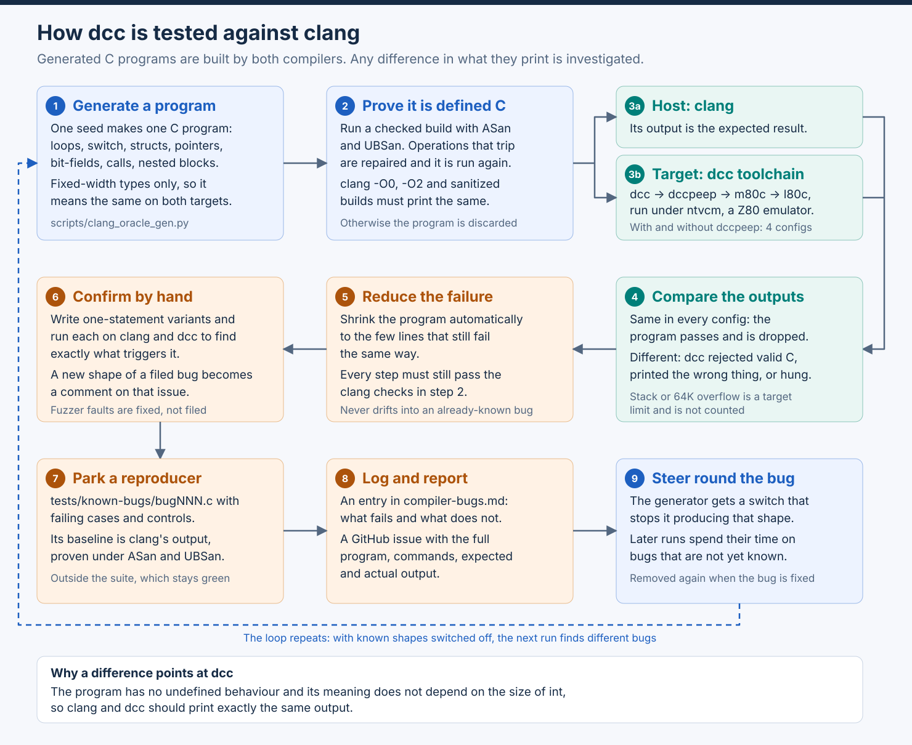

# Fuzz testing

Fuzz testing automatically generates or mutates many inputs and checks the results. For dcc, it explores unusual combinations of C features and malformed inputs, revealing miscompilations, crashes, and hangs that tests written by hand can miss.

## How seeds work

A seed is an integer that controls the fuzzer's random choices. Each seed generates a test program or selects and mutates an existing C file. Use `--seeds 17` to run one seed, `--seeds 1-20` to try an inclusive range, or `--seeds 1-20,250` to combine ranges and individual seeds.

To replay a failure, run the reported seed with the same checkout and options. Save the generated C file and any headers with the failure log, since changes to the generator or its inputs can change what a seed produces.

## Running a campaign

Run these commands from the repository root with Python 3.9 or later and a built [DCC toolchain](../00-setup-toolchain.md). Put `ntvcm` on `PATH` for the Clang oracle, typed expression, and runtime library fuzzers. `clang` is required by the Clang and runtime fuzzers and by the syntax fuzzer's `--accepts` option. Use `--help` on any driver to see all its options.

All four fuzzers take `--seeds` to select inputs and `--jobs` to set the number of parallel workers. Run this setup in Bash or Zsh before using the examples below in the same shell. `tee` displays and saves the output, and `pipefail` preserves a failure status from the fuzzer. A typical campaign runs tens of thousands of seeds. For a quick check, use `--seeds 1-20`.

```bash
set -o pipefail
JOBS="${JOBS:-$(nproc 2>/dev/null || sysctl -n hw.ncpu 2>/dev/null || echo 4)}"
mkdir -p build
```

## Clang oracle (`clang-oracle-fuzz.py`)

Generates C programs and compares dcc's output with Clang's. The `int` generator exercises integer code generation, `float` covers floating point arithmetic and conversions, and `frontend` targets preprocessing and parsing.

```bash
python3 scripts/clang-oracle-fuzz.py --gen int \
  --seeds 260001-300000 --configs production --jobs "$JOBS" \
  2>&1 | tee build/fuzz-int.log

python3 scripts/clang-oracle-fuzz.py --gen float \
  --seeds 260001-300000 --configs production --jobs "$JOBS" \
  2>&1 | tee build/fuzz-float.log

python3 scripts/clang-oracle-fuzz.py --gen frontend \
  --seeds 300000-400000 --configs production --jobs "$JOBS" \
  2>&1 | tee build/fuzz-frontend.log
```

`--configs production` tests combinations of peephole optimization and stack checking. Add `--off known` to skip generated forms associated with logged bugs.

Integer and float campaigns also run frontend probes on up to eight seeds. The probes have a separate tally and contribute to the campaign exit status. Eight consecutive seeds cover macro and literal checks, token rescanning, conditional directives, nested headers, lexical tokens, declarators, initializers, constant expressions, and VLA scopes. Use `--gen frontend` to probe the full range or to generate or reduce a frontend failure. Keep generated headers with the source when replaying an include case.

The final tally reports failures, passes, and `INVALID` inputs rejected by the host checks. Two consecutive clean batches after the last generator change are a reasonable stopping point.

Use `--configs all` to also force every MIR candidate emitter. This takes roughly ten times the work, so use a smaller batch. Record the configuration if a failure occurs only when an emitter is forced. Use `--list-configs` to list the available configurations.

```sh
python3 scripts/clang-oracle-fuzz.py --gen int --seeds 1-150 --configs all --off known --jobs 3
python3 scripts/clang-oracle-fuzz.py --list-configs
```

### How it works

The host compiler is the oracle. This method adapts the approach used by Csmith and similar tools to a target where `int` is 16 bits and `float` is the only floating point type.

[](../images/clang-oracle-testing.svg)

1. **Generate a program.** One seed produces one self-contained C program:
   helper and test functions over fixed-width integers, arrays, structs,
   unions, bit-fields and pointers, with loops, `switch`, nested-block
   locals, `goto`, calls with mixed-width arguments, bounded recursion,
   calls through function pointers, comma expressions, pointer differences
   and calls to a variadic function. The float generator adds `float` objects of
   every storage class, arithmetic, comparison, `?:`, `++`/`--`, compound
   assignment and conversions to and from every integer width. The program
   never spells `int` or `long`; the renderer inserts the casts and masks that
   make every expression mean the same with a 16-bit and a 32-bit `int`.
2. **Prove it is defined C.** What a cast cannot fix — signed overflow at 16
   bits, division by zero, out-of-range shifts, an unsequenced modification —
   is caught on the host. A second rendering routes each such operation
   through a checking helper and is built with ASan and UBSan; operations
   that trip are repaired and the program is checked again. It is used only
   when the checked build reports nothing, clang finds no unsequenced
   modification or C23-only syntax, and the `-O0`, `-O2`, sanitized and
   checked builds all print the same. Otherwise it is discarded as `INVALID`.
3. **Build on both sides.** clang's output is the expected result. dcc builds
   the same source through `dcc → dccpeep → m80c → l80c` and runs it under
   `ntvcm`, in each production configuration: with and without `dccpeep`,
   with and without the stack check. `--configs all` adds one configuration
   per MIR candidate emitter, forced with `DCC_MIR_SELECT_CANDIDATE`, so the
   emitters the cost policy does not pick today are exercised as well.
4. **Compare.** Same output in every configuration: the program passes and
   its files are deleted. Otherwise the seed is reported as `COMPILE` (valid
   C rejected), `VERIFY` (a MIR verifier diagnostic), `MISMATCH`, `RUN-HANG`
   or `BUILD-HANG`. A program that only overflows the target stack, does not
   fit in 64K, or reports `out of ram` has met a limit of the target, not a
   defect, and is counted as `limit-only`.
5. **Reduce.** A failing seed is shrunk automatically to the few lines that
   still fail the same way. Every candidate edit must still pass the host
   checks of step 2, and the reducer refuses edits that would turn the
   failure into one already logged.
6. **Confirm by hand.** One-statement variants of the reduced program are
   run on both compilers to find exactly which shape triggers the defect and
   which neighbouring shapes are right. A new shape of a filed bug becomes a
   comment on that issue rather than a new one; a fault in the fuzzer itself
   is fixed, not filed.
7. **Park a reproducer.** `tests/known-bugs/bugNNN.c` holds the failing
   cases with passing controls. Its baseline is clang's output, proven under
   ASan and UBSan. These programs are kept outside `tests/*.c`, so the
   regression suite stays green while the bug is open.
8. **Log and report.** The bug gets an entry and a summary-table row in
   `compiler-bugs.md`, a GitHub issue, and a steering rule in the generator
   so later runs look for something new instead of finding the same bug
   again.

The outputs are deliberately plain: one line per call with the returned
value, or a checksum of every global after the call, printed as hex. Floats
are printed as their IEEE bits with `-0` folded to `0`, so a difference is a
difference in the arithmetic, not in formatting, and a one-ulp error is
visible.

### Tools

The Clang oracle and its companion scripts live in `scripts/`.

| Tool | Role |
| --- | --- |
| `clang-oracle-fuzz.py` | The driver: generation, host proof, dcc build and run in each configuration, comparison, reduction |
| `clang_oracle_gen.py` | The integer program model, generator, renderers and undefined-behaviour repair; `KNOWN_BUGS` maps generator features to logged bugs |
| `clang_oracle_float_gen.py` | The float generator, built on the same model; selected with `--gen float` |
| `clang_oracle_frontend_gen.py` | Preprocessor and parser probes, run automatically on the first eight seeds of integer and float campaigns |
| `run-known-bugs.py` | Checks every parked reproducer: proves its baseline on the host, then reports `fails` or `FIXED` for dcc with and without `dccpeep` |
| `bug-issue-body.py` | Writes a GitHub issue body for an entry in `compiler-bugs.md` from the reproducer, its baseline and dcc's current behaviour; `--create` opens the issue |

The full option list is in `scripts/README.md` and `--help`.

### Reducing a failure

Reduce a failure under one configuration, with a short timeout so a hang
reduces quickly:

```sh
python3 scripts/clang-oracle-fuzz.py --gen int --reduce 4750 --config nopeep --off known --timeout 3
```

The result is `build/clang-oracle-fuzz/4750-reduce-nopeep/reduced.c` with `reduced.expected` and `reduced.actual` beside it. Keep the reduced program and record the generator version and the `--gen`, `--tests`, `--size`, `--depth` and `--off` options used in the run.

### Logging a bug

1. Confirm the reduced program by hand with one-statement variants, and check
   `compiler-bugs.md` for an entry with the same root shape. A new shape of
   an existing bug is a bullet in that entry and a comment on its issue.
2. Write `tests/known-bugs/bugNNN.c` with the failing cases and passing
   controls, using `<stdint.h>` types only, and let the host write its
   baseline:

    ```sh
    python3 scripts/run-known-bugs.py --update bugNNN
    python3 scripts/run-known-bugs.py bugNNN
    ```

3. Add a `## BUG-NNN` entry and a summary-table row to `compiler-bugs.md`,
   and update the open count.
4. Generate and open the issue, then put its number in the table row:

    ```sh
    python3 scripts/bug-issue-body.py bugNNN --create
    ```

5. Steer the generator round the shape: add a feature to `FEATURES` and
   `KNOWN_BUGS` in the generator, a detector in `known_shapes()`, and the
   rewrite that avoids it. Confirm that no program over a few thousand seeds
   still contains a known shape with `--off known`, then rerun the campaign.

### When a bug is fixed

`run-known-bugs.py` reports the reproducer as `FIXED`. Promote it to a
regular test — move it to `tests/<name>.c` with its baseline, add its row to
`tests/perf_baselines.csv`, close the entry in `compiler-bugs.md`, and remove
the bug's feature from `KNOWN_BUGS` so the fuzzer generates that form again.
`tests/known-bugs/README.md` has the exact steps. `fix-plan.md` in the
repository root groups the open bugs by probable root cause so that related
ones are fixed together, and the project skill
`.github/skills/dcc-fuzz-testing/references/clang-oracle.md` has the
procedure for running a clang oracle campaign, triaging a failure and
verifying a fix.

### What this does and does not find

The fuzzer finds wrong code, rejected valid C, verifier diagnostics,
compile-time crashes and hangs in the shapes the generator can produce.
Because every program is proven defined on the host, every report is a real
defect, not a porting difference, and the reproducer is small enough to
read.

It does not cover the standard library, I/O, the preprocessor beyond what the
generated programs use, or behaviour that depends on CP/M. It cannot judge
performance. And it only explores the language surface the generators know
about, so extending a generator — a new statement form, a new lvalue kind, a
new conversion — is how the search is widened.

## Typed expressions (`typed-expr-fuzz.py`)

Checks integer expressions and small programs against a Python model of dcc's integer widths and conversions, with and without peephole optimization. Use `--mode tree` for nested expressions, `store` for updates to stored values, or `prog` and `scope` for small programs with calls and control flow.

```bash
python3 scripts/typed-expr-fuzz.py --seeds 1-20000 --jobs "$JOBS" \
  2>&1 | tee build/fuzz-typed-expr.log
```

## Runtime library (`rtl-oracle-fuzz.py`)

Compares dcc's runtime results with a native Clang build for cases such as formatted I/O, strings, math, allocation and file operations. Add `--io-matrix` to exercise all four combinations of float and long formatted I/O support.

```bash
python3 scripts/rtl-oracle-fuzz.py --seeds 1-20000 --jobs "$JOBS" \
  2>&1 | tee build/fuzz-rtl.log
```

## Syntax and diagnostics (`syntax-crash-fuzz.py`)

Mutates C files from `tests/` and checks for crashes, hangs and diagnostic failures. Add `--directives` to focus on preprocessor directives or `--accepts` to flag syntax dcc accepts that Clang rejects. Pass an AddressSanitizer and UndefinedBehaviorSanitizer build with `--dcc PATH` to detect sanitizer errors too.

```bash
python3 scripts/syntax-crash-fuzz.py --seeds 1-20000 --jobs "$JOBS" \
  2>&1 | tee build/fuzz-syntax.log
```
