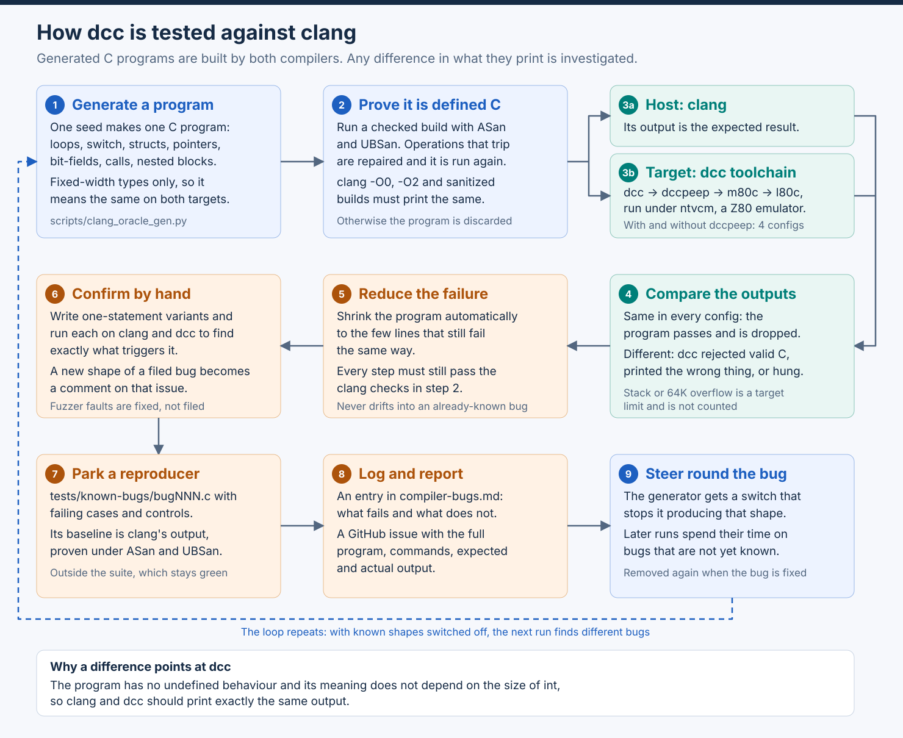

# Appendix: differential testing against clang

The regression suite in `tests/` checks that programs people have written
still behave. It cannot find a bug in a shape nobody has written yet. This
appendix describes the second line of testing: a *differential fuzzer* that
generates C programs, lets the host C compiler say what each one should
print, and reports where the DCC C Compiler disagrees.

The host compiler is the oracle. clang is a mature, heavily tested compiler,
so when it and dcc print different things for a program that is defined C,
the fault is almost always dcc's. The method is the same one Csmith and
similar tools use for mainstream compilers, adapted to a target whose `int` is
16 bits wide and whose only floating type is `float`.

[](../images/clang-oracle-testing.svg)

## How it works

1. **Generate a program.** One seed produces one self-contained C program:
   helper and test functions over fixed-width integers, arrays, structs,
   bit-fields and pointers, with loops, `switch`, nested-block locals,
   `goto`, calls with mixed-width arguments, bounded recursion and calls
   through function pointers. The float generator adds `float` objects of
   every storage class, arithmetic, comparison, `?:`, `++`/`--`, compound
   assignment and conversions to and from every integer width. The program
   never spells `int` or `long`; the renderer inserts the casts and masks that
   make every expression mean the same with a 16-bit and a 32-bit `int`.
2. **Prove it is defined C.** What a cast cannot fix — signed overflow at 16
   bits, division by zero, out-of-range shifts, an unsequenced modification —
   is caught on the host. A second rendering routes each such operation
   through a checking helper and is built with ASan and UBSan; operations
   that trip are repaired and the program is checked again. It is used only
   when the checked build reports nothing, clang finds no unsequenced
   modification or C23-only syntax, and the `-O0`, `-O2`, sanitized and
   checked builds all print the same. Otherwise it is discarded as `INVALID`.
3. **Build on both sides.** clang's output is the expected result. dcc builds
   the same source through `dcc → dccpeep → m80c → l80c` and runs it under
   `ntvcm`, in each production configuration: with and without `dccpeep`,
   with and without the stack check. `--configs all` adds one configuration
   per MIR candidate emitter, forced with `DCC_MIR_SELECT_CANDIDATE`, so the
   emitters the cost policy does not pick today are exercised as well.
4. **Compare.** Same output in every configuration: the program passes and
   its files are deleted. Otherwise the seed is reported as `COMPILE` (valid
   C rejected), `VERIFY` (a MIR verifier diagnostic), `MISMATCH`, `RUN-HANG`
   or `BUILD-HANG`. A program that only overflows the target stack, does not
   fit in 64K, or reports `out of ram` has met a limit of the target, not a
   defect, and is counted as `limit-only`.
5. **Reduce.** A failing seed is shrunk automatically to the few lines that
   still fail the same way. Every candidate edit must still pass the host
   checks of step 2, and the reducer refuses edits that would turn the
   failure into one already logged.
6. **Confirm by hand.** One-statement variants of the reduced program are
   run on both compilers to find exactly which shape triggers the defect and
   which neighbouring shapes are right. A new shape of a filed bug becomes a
   comment on that issue rather than a new one; a fault in the fuzzer itself
   is fixed, not filed.
7. **Park a reproducer.** `tests/known-bugs/bugNNN.c` holds the failing
   cases with passing controls. Its baseline is clang's output, proven under
   ASan and UBSan. These programs are kept outside `tests/*.c`, so the
   regression suite stays green while the bug is open.
8. **Log and report.** The bug gets an entry and a summary-table row in
   `compiler-bugs.md`, a GitHub issue, and a steering rule in the generator
   so later runs look for something new instead of finding the same bug
   again.

The outputs are deliberately plain: one line per call with the returned
value, or a checksum of every global after the call, printed as hex. Floats
are printed as their IEEE bits with `-0` folded to `0`, so a difference is a
difference in the arithmetic, not in formatting, and a one-ulp error is
visible.

## Tools

All of these live in `scripts/`, run on the host with Python 3.9 or later,
and need clang, `ntvcm` and a built toolchain in the repository root.

| Tool | Role |
| --- | --- |
| `clang-oracle-fuzz.py` | The driver: generation, host proof, dcc build and run in each configuration, comparison, reduction |
| `clang_oracle_gen.py` | The integer program model, generator, renderers and undefined-behaviour repair; `KNOWN_BUGS` maps generator features to logged bugs |
| `clang_oracle_float_gen.py` | The float generator, built on the same model; selected with `--gen float` |
| `run-known-bugs.py` | Checks every parked reproducer: proves its baseline on the host, then reports `fails` or `FIXED` for dcc with and without `dccpeep` |
| `bug-issue-body.py` | Writes a GitHub issue body for an entry in `compiler-bugs.md` from the reproducer, its baseline and dcc's current behaviour; `--create` opens the issue |
| `typed-expr-fuzz.py` | The older single-expression fuzzer, checked against a Python model rather than clang |

The full option list is in `scripts/README.md` and `--help`.

## Running a campaign

Fuzz a range of seeds in the production configurations, leaving out every
form that hits a bug already logged:

```sh
python3 scripts/clang-oracle-fuzz.py --seeds 1-300 --configs production --off known
python3 scripts/clang-oracle-fuzz.py --gen float --seeds 1-300 --configs production --off known
```

A 300-seed batch takes about ten minutes on a laptop with `--jobs 6`. The
last line is the tally, for example `300 programs: FAIL 1, INVALID 29,
ok 270`; an `INVALID` rate of ten to fifteen percent is normal and means the
host proof rejected programs that were not defined C.

Reduce a failure under one configuration, with a short timeout so a hang
reduces quickly:

```sh
python3 scripts/clang-oracle-fuzz.py --reduce 4750 --config nopeep --off known --timeout 3
```

The result is `build/clang-oracle-fuzz/4750-reduce-nopeep/reduced.c` with
`reduced.expected` and `reduced.actual` beside it. Keep the reduced program,
not the seed: a seed names a program only together with the generator version
and the `--tests`, `--size`, `--depth` and `--off` options.

Force every MIR candidate emitter as well. This is roughly ten times the
work, so use smaller batches, and remember that a failure only in a forced
configuration is latent rather than shipped behaviour:

```sh
python3 scripts/clang-oracle-fuzz.py --seeds 1-150 --configs all --off known --jobs 3
python3 scripts/clang-oracle-fuzz.py --list-configs
```

A reasonable stop rule for a campaign is two consecutive clean batches after
the last change to the generator. Changing the generator re-randomises every
seed, so the count restarts.

## Logging a bug

1. Confirm the reduced program by hand with one-statement variants, and check
   `compiler-bugs.md` for an entry with the same root shape. A new shape of
   an existing bug is a bullet in that entry and a comment on its issue.
2. Write `tests/known-bugs/bugNNN.c` with the failing cases and passing
   controls, using `<stdint.h>` types only, and let the host write its
   baseline:

    ```sh
    python3 scripts/run-known-bugs.py --update bugNNN
    python3 scripts/run-known-bugs.py bugNNN
    ```

3. Add a `## BUG-NNN` entry and a summary-table row to `compiler-bugs.md`,
   and update the open count.
4. Generate and open the issue, then put its number in the table row:

    ```sh
    python3 scripts/bug-issue-body.py bugNNN --create
    ```

5. Steer the generator round the shape: add a feature to `FEATURES` and
   `KNOWN_BUGS` in the generator, a detector in `known_shapes()`, and the
   rewrite that avoids it. Confirm that no program over a few thousand seeds
   still contains a known shape with `--off known`, then rerun the campaign.

## When a bug is fixed

`run-known-bugs.py` reports the reproducer as `FIXED`. Promote it to a
regular test — move it to `tests/<name>.c` with its baseline, add its row to
`tests/perf_baselines.csv`, close the entry in `compiler-bugs.md`, and remove
the bug's feature from `KNOWN_BUGS` so the fuzzer generates that form again.
`tests/known-bugs/README.md` has the exact steps.

## What this does and does not find

The fuzzer finds wrong code, rejected valid C, verifier diagnostics,
compile-time crashes and hangs in the shapes the generator can produce.
Because every program is proven defined on the host, every report is a real
defect, not a porting difference, and the reproducer is small enough to
read.

It does not cover the standard library, I/O, the preprocessor beyond what the
generated programs use, or behaviour that depends on CP/M. It cannot judge
performance. And it only explores the language surface the generators know
about, so extending a generator — a new statement form, a new lvalue kind, a
new conversion — is how the search is widened.
